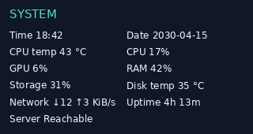
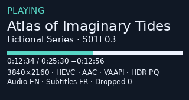
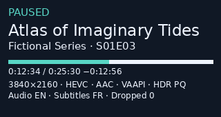

# S1 Media Panel

Tableau de bord libre pour le LCD frontal des mini-PC compatibles ACEMAGIC S1 sous Linux. Version expérimentale **0.1.0-alpha**. [English](README.md).

| Repos | Lecture | Pause |
| --- | --- | --- |
|  |  |  |

Les vues basculent automatiquement via MPRIS. Le socket privé MPV, facultatif, enrichit les informations de Jellyfin MPV Shim. Le tableau de bord peut fonctionner sans lecteur ni serveur. Les aperçus utilisent des données fictives.

## Matériel et prérequis

- **Tests automatisés.** La suite comprend 15 tests de luminosité et les 25 tests de régression de l’alpha couvrant la formation des trames, les erreurs USB et la reprise simulées, la cadence du heartbeat, la configuration, le rendu et les transitions multimédias.
- **Installation Python.** Le wheel et le paquet source ont été installés avec résolution des dépendances sous Lubuntu 26.04 et Python 3.14. Les 25 tests et la désinstallation ont réussi dans chaque environnement.
- **Observations matérielles antérieures.** L’intégration privée a affiché le tableau de bord au repos et la vue en lecture sur Intel N95, Lubuntu 26.04, Holtek USB `04d9:fd01` révision `0110`, interface `01`, endpoint OUT interrupt `0x02`, 320 × 170 RGB565. La référence commerciale précise du châssis reste inconnue.
- **Périmètre de l’alpha publique.** Cette version n’a fait l’objet d’aucun essai sur LCD physique ni d’aucun essai d’endurance. Les observations antérieures aident à choisir une révision de contrôleur pour les essais de la communauté.

Il faut Linux, Python 3.11+, libusb 1.x, DejaVu Sans ou une police TrueType choisie, Pillow, psutil, PyUSB et dbus-python. La lecture requiert une session D-Bus. Sur Debian ou Ubuntu, installer les prérequis système suivants avec les droits administrateur :

```sh
sudo apt install python3-venv python3-dev build-essential pkg-config \
  libdbus-1-dev libglib2.0-dev libusb-1.0-0 fonts-dejavu-core
```

Le compilateur, les en-têtes Python, `pkg-config` et les paquets de développement D-Bus et GLib sont nécessaires si pip compile `dbus-python`. Choisir les en-têtes de l’interpréteur utilisé pour créer l’environnement virtuel. Le wheel et le paquet source ont été installés et testés sous Python 3.14, avec compilation de dbus-python 1.5.1.

## Installation, configuration et démarrage

Suivre les [commandes d’installation](README.md#install-and-run) pour créer un environnement Python utilisateur, installer le projet et conserver les réglages existants. Valider le TOML avec `--check-config` et générer les aperçus avec `--preview`.

Consulter les [permissions USB](docs/permissions.md) avant toute installation de la règle udev par un administrateur. Lancer d’abord le programme au premier plan, avec une seule application pilotant le LCD. L’unité systemd utilisateur fournie peut ensuite être activée avec la procédure du README anglais.

Personnaliser `config.toml` depuis `config.example.toml` ou choisir un fichier avec `--config PATH`. Le socket MPV et la sonde HTTPS sont désactivés par défaut. La [documentation technique](docs/technical.md) décrit leur configuration, les mesures et le diagnostic.

## Luminosité manuelle

`s1-media-panel brightness set 65` règle toutes les vues à 65 %. Le réglage propose 21 niveaux et reste mémorisé après redémarrage. À 0 %, les pixels sont noirs et le service continue de fonctionner. À 100 %, le thème retrouve sa pleine intensité. **La luminosité logicielle ne modifie pas le rétroéclairage matériel du LCD.**

`s1-media-panel brightness panel` ouvre le curseur indépendant. Pour afficher le pourcentage sur le bureau pendant deux secondes, utiliser par exemple `s1-media-panel brightness --osd up`. L’installation de référence a été validée sur le bureau LXQt. La superposition au-dessus de Jellyfin en plein écran reste à vérifier. Le guide détaille l’installation de PyQt6, la migration des anciens réglages et les quatre raccourcis facultatifs. [Guide illustré de la luminosité](docs/luminosite.md)

## Désinstallation

Si l’unité est active, utiliser `systemctl --user disable --now s1-media-panel.service`. Retirer son fichier du dossier des unités utilisateur puis lancer `systemctl --user daemon-reload`. Supprimer l’environnement Python dédié et, au choix, la configuration et les aperçus. Si la règle udev a été installée pour ce projet, demander à l’administrateur de retirer cette règle précise et de réappliquer la politique du contrôleur.

## Limites et contributions

La luminosité est logicielle. Le rétroéclairage, les LED et le firmware ne sont pas pilotés. Le portrait, la reconnexion physique et le rafraîchissement rectangulaire restent à qualifier. Direct Play et transcodage ne sont pas déduits de MPRIS ou MPV. Dolby Vision nécessite un profil explicitement rapporté. Les mesures indisponibles sont masquées. Les retours d’essai sont bienvenus. Indiquer la révision USB, la distribution, les observations et des diagnostics expurgés.

## Crédits et remerciements

- **FalledCan** a écrit le pilote LCD Python d’origine, utilisé et adapté dans ce projet. [acemagic-s1-lcd](https://github.com/FalledCan/acemagic-s1-lcd)
- **Tomasz Jaworski (tjaworski)** a analysé et rétro-ingéniéré le protocole LCD. Son travail a servi de base au pilote Python et à la gestion des commandes d’affichage de ce projet. [AceMagic-S1-LED-TFT-Linux](https://github.com/tjaworski/AceMagic-S1-LED-TFT-Linux)

Merci aux deux auteurs d’avoir partagé leur travail. S1 Media Panel ajoute au pilote adapté un tableau de bord système configurable, des vues de lecture multimédia et une configuration de service utilisateur sous Linux.

GPL-3.0-only. [Attributions](ATTRIBUTIONS.md) · [Licence](LICENSE) · [Guide de contribution](CONTRIBUTING.md).
