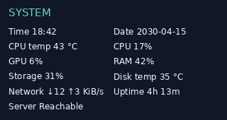
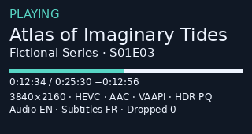
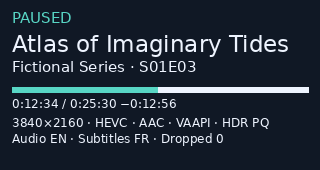

# S1 Media Panel

An open-source LCD dashboard for ACEMAGIC S1 Linux media centers, featuring system monitoring and dynamic multimedia playback information.

Experimental release **0.1.0-alpha**. [Lire en français](README.fr.md).

| Idle | Playing | Paused |
| --- | --- | --- |
|  |  |  |

The panel switches between system metrics and playback using MPRIS. An optional private MPV socket supplies video and track details for Jellyfin MPV Shim. The dashboard works independently of a player or server. The examples are generated with fictional data.

## Hardware and prerequisites

- **Automated checks:** The suite includes 15 brightness tests and the original 25 regression tests covering framing, USB errors and recovery with simulated devices, heartbeat scheduling, configuration, rendering and media state transitions.
- **Python installation:** wheel and source distribution were installed with dependency resolution on Lubuntu 26.04 and Python 3.14. All 25 tests passed in each environment, and uninstallation succeeded.
- **Historical hardware observations:** an earlier private integration displayed the idle dashboard and the playback view on Intel N95, Lubuntu 26.04, Holtek USB `04d9:fd01` revision `0110`, interface `01`, interrupt OUT endpoint `0x02`, 320 × 170 RGB565. The exact retail chassis was not verified.
- **Public alpha scope:** no physical LCD or endurance test was performed with this release. The historical observations help identify a candidate controller revision for community testing.

Requirements are Linux, Python 3.11+, libusb 1.x, DejaVu Sans or a configured TrueType font, Pillow, psutil, PyUSB and dbus-python. A D-Bus session is needed for playback. The dashboard can run without one. On Debian/Ubuntu, install the following system prerequisites as an administrator:

```sh
sudo apt install python3-venv python3-dev build-essential pkg-config \
  libdbus-1-dev libglib2.0-dev libusb-1.0-0 fonts-dejavu-core
```

The compiler, Python headers, `pkg-config`, D-Bus and GLib development packages are required if pip builds `dbus-python` from source. Use headers for the interpreter that creates the virtual environment. Package names can vary by distribution. The wheel and source package were installed and tested with Python 3.14, including a build of dbus-python 1.5.1.

## Install and run

From the source directory, as your regular user, run each command in order and stop if a command fails:

```sh
base="$HOME/.local/share/s1-media-panel"
cfg="${XDG_CONFIG_HOME:-$HOME/.config}/s1-media-panel"
python3 -m venv "$base/venv"
"$base/venv/bin/python" -m pip install .
install -d -m 700 "$cfg"
if [ ! -e "$cfg/config.toml" ]; then
  install -m 600 config.example.toml "$cfg/config.toml"
fi
"$base/venv/bin/s1-media-panel" --check-config
"$base/venv/bin/s1-media-panel" --preview ./preview
```

Review [USB permissions](docs/permissions.md) before installing the udev template. Run `"$base/venv/bin/s1-media-panel"` in the foreground once access is granted. Keep a single application in charge of the LCD.

For autostart, install the provided unit after checking its virtual-environment path:

```sh
units="${XDG_CONFIG_HOME:-$HOME/.config}/systemd/user"
mkdir -p "$units"
if [ ! -e "$units/s1-media-panel.service" ]; then
  install -m 644 contrib/systemd/s1-media-panel.service "$units/s1-media-panel.service"
fi
systemctl --user daemon-reload
systemctl --user enable --now s1-media-panel.service
```

## Configure

Edit `config.toml` in the configuration directory or pass `--config PATH`. The example lists the settings and defaults. Configure the USB selector, orientation, refresh and retry intervals, theme colors, monitoring fields, and media source. MPV IPC and the HTTPS probe are disabled until configured. See [technical documentation](docs/technical.md) for local socket setup, metrics and diagnostics.

## Manual LCD brightness

From the source checkout, install the optional graphical controls into the same virtual environment with `"$base/venv/bin/python" -m pip install '.[gui]'`. The service and text commands work without PyQt6. With the environment's `bin` directory on PATH:

```sh
s1-media-panel brightness status
s1-media-panel brightness set 0
s1-media-panel brightness up
s1-media-panel brightness down
s1-media-panel brightness set 100
s1-media-panel brightness panel
s1-media-panel brightness --osd set 65
```

The 21 levels apply to all views. At 0% the pixels are black and the service continues its heartbeat. At 100% the theme is drawn at full intensity. Intermediate levels scale RGB pixels before RGB565 encoding. **Software brightness does not change the hardware backlight.** Closing the slider panel leaves the LCD service running.

The level is saved atomically under `$XDG_STATE_HOME/s1-media-panel/brightness` (default `~/.local/state/s1-media-panel/brightness`). It defaults to 100%. Older TOML files still load. The three per-mode brightness keys are ignored. Use `set` to select a new level or repair a malformed preference.

`--osd` requests a single overlay on the primary screen and renews its two-second timeout. The reference integration was validated on the LXQt desktop. This source implementation was tested offscreen. Stacking over fullscreen Jellyfin remains unverified. The panel and overlay use no USB access. See the [illustrated controls and optional LXQt shortcuts (French)](docs/luminosite.md).

## Uninstall

Run `systemctl --user disable --now s1-media-panel.service` if installed. Remove that unit from your user unit directory and run `systemctl --user daemon-reload`. Remove the dedicated virtual environment and optionally the saved configuration and preview directory. If you installed the USB rule for this application, an administrator can remove that specific rule, reload udev and reapply access policy for the matching controller as described in [USB permissions](docs/permissions.md).

## Limitations and contributions

Hardware backlight, LED control and firmware changes are outside scope. Physical reconnect, long uptime, portrait rendering on hardware and rectangular refresh remain unverified for this alpha. MPRIS and local MPV do not establish server Direct Play or transcoding. Dolby Vision is shown only for an explicit profile. Missing metrics are omitted. Hardware reports are welcome. Include the USB revision, distribution, observations and sanitized diagnostics. See [tests and diagnostics](docs/technical.md) and [contribution guidance](CONTRIBUTING.md).

## Credits and thanks

- **FalledCan** wrote the original Python LCD driver that this project uses and adapts. [acemagic-s1-lcd](https://github.com/FalledCan/acemagic-s1-lcd)
- **Tomasz Jaworski (tjaworski)** analyzed and reverse-engineered the LCD protocol. That work informed the Python driver and this project's handling of display commands. [AceMagic-S1-LED-TFT-Linux](https://github.com/tjaworski/AceMagic-S1-LED-TFT-Linux)

Thank you both for sharing your work. S1 Media Panel adds a configurable system dashboard, media playback views and a Linux user-service setup around the adapted driver.

Licensed under GPL-3.0-only. See [attributions](ATTRIBUTIONS.md) and [license](LICENSE).
