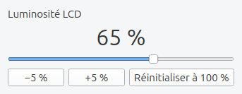

# Régler la luminosité du LCD

Depuis le dépôt source, la commande de base est `s1-media-panel brightness`. Dans les exemples ci-dessous, le dossier `bin` de l’environnement virtuel figure dans le PATH. Pour un raccourci de bureau, indiquer le chemin absolu de **son propre** exécutable `s1-media-panel`.

## Installation

Le service LCD et la CLI texte utilisent les dépendances habituelles du projet. Le panneau et l’OSD requièrent PyQt6 et une session graphique Linux. Pour ajouter cette option depuis le dépôt, utiliser le Python de l’environnement virtuel créé à l’installation.

```sh
"$HOME/.local/share/s1-media-panel/venv/bin/python" -m pip install '.[gui]'
```

L’OSD utilise aussi le répertoire privé de session `XDG_RUNTIME_DIR`. Le panneau et l’OSD s’exécutent sous le même compte que le service. Aucun de ces outils graphiques ne demande d’accès USB.

## Commandes

| Commande | Effet |
| --- | --- |
| `s1-media-panel brightness status` | Lire le pourcentage mémorisé |
| `s1-media-panel brightness set 0` | Afficher des pixels noirs |
| `s1-media-panel brightness set 65` | Régler à 65 % |
| `s1-media-panel brightness up` | Augmenter de 5 points, jusqu’à 100 % |
| `s1-media-panel brightness down` | Diminuer de 5 points, jusqu’à 0 % |
| `s1-media-panel brightness set 100` | Retrouver le rendu pleine intensité |
| `s1-media-panel brightness panel` | Ouvrir le panneau indépendant |

Les 21 valeurs autorisées vont de 0 à 100 % inclus. Une valeur hors plage ou hors palier est refusée. Le curseur du panneau suit les mêmes paliers. Relâcher le curseur pour enregistrer, utiliser les boutons pour ajuster de cinq points ou rétablir 100 %. Le panneau suit aussi les changements faits en ligne de commande. Sa fermeture laisse le service actif.



## Indicateur sur le bureau

`s1-media-panel brightness --osd down` ajuste la valeur et affiche « Luminosité LCD », le pourcentage et une barre près du bas de l’écran principal. L’indicateur se ferme deux secondes après la dernière demande. Des appuis rapprochés actualisent la même fenêtre, même à une borne. La fenêtre demande à rester au-dessus des autres fenêtres et à laisser le clavier et la souris à l’application active.


Le fonctionnement sur le bureau LXQt a été validé sur l’installation de référence. Le portage public a été testé avec Qt hors écran. La superposition et le focus au-dessus de Jellyfin en plein écran restent à vérifier. Sous Wayland ou avec un autre gestionnaire de fenêtres, le positionnement et la superposition dépendent du compositeur. Si l’ouverture de l’OSD échoue, la CLI signale l’erreur après avoir enregistré le réglage. Vérifier le résultat avec `s1-media-panel brightness status`.

## Exemples de raccourcis LXQt

Ces quatre affectations reprennent celles de la machine de référence. Leur configuration est facultative et manuelle.

| Touche | Commande du raccourci |
| --- | --- |
| F9 | `s1-media-panel brightness --osd set 0` |
| F10 | `s1-media-panel brightness --osd set 100` |
| Super+Maj+F11 | `s1-media-panel brightness --osd down` |
| Super+Maj+F12 | `s1-media-panel brightness --osd up` |

## Persistance, migration et limites physiques

La préférence vaut 100 % au premier démarrage. Elle est enregistrée dans `$XDG_STATE_HOME/s1-media-panel/brightness`, ou dans `~/.local/state/s1-media-panel/brightness` si la variable est absente ou relative. Utiliser la même racine pour le service et ses commandes. Le fichier privé est remplacé atomiquement sous verrou. La valeur reste disponible après redémarrage du service ou de l’ordinateur. Le service la relit à chaque cycle, selon `service.poll` (0,5 s par défaut, hors temps de transfert).

Une préférence malformée est signalée. Le service garde le dernier niveau valide, ou 100 % au démarrage. Pour la réparer, choisir un niveau explicite avec `set` ou utiliser le bouton de réinitialisation. Les anciens TOML restent lisibles. Les clés `idle_brightness`, `playing_brightness` et `paused_brightness` sont acceptées pour compatibilité et ignorées. Choisir une seule fois le pourcentage souhaité après la mise à jour. Les couleurs personnalisées du thème sont conservées.

La luminosité logicielle ne modifie **pas** le rétroéclairage matériel du LCD. À 0 %, les pixels sont noirs et le contrôleur continue de recevoir ses signaux de présence. Une lueur de la dalle peut rester visible. Entre 5 et 95 %, les canaux rouge, vert et bleu sont atténués avant l’encodage RGB565. À 100 %, le rendu RGB du thème est transmis sans atténuation. L’heure, la lecture, la pause et le retour au repos ne changent jamais le niveau choisi.
